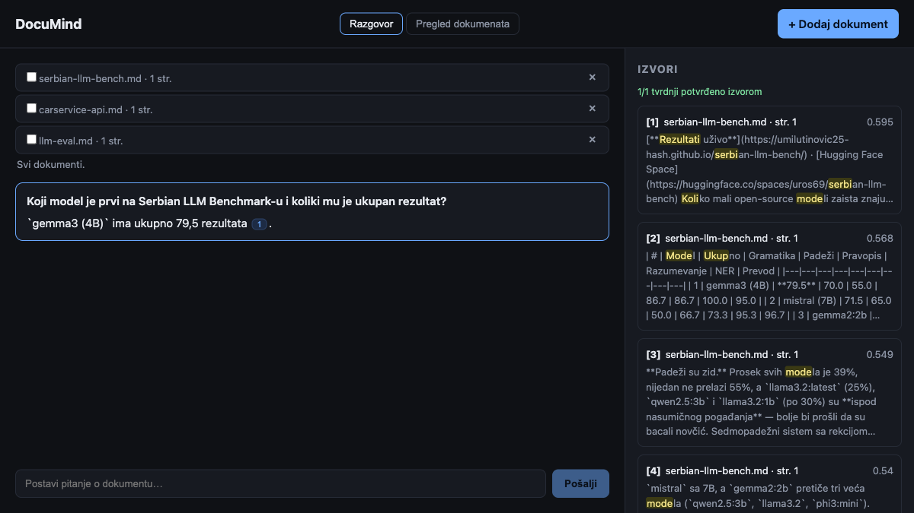
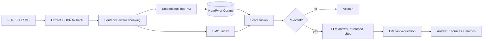

# DocuMind

Private document Q&A with **cited, verified answers**. Hybrid retrieval, abstention instead of
guessing, a deterministic citation check, and an evaluation harness that can gate CI.
Local-first: embeddings and generation run on [Ollama](https://ollama.com); Claude is used when
`ANTHROPIC_API_KEY` is set.



## What makes it different
- **Verified citations.** Every cited sentence is checked against the source it cites (numbers, codes
  and content words, deterministic, no LLM judge). Weak claims and non-existent `[7]`-style sources
  are flagged in the UI instead of being trusted.
- **Honest refusal.** When the documents don't contain the answer it says so (`answered: false`,
  no fake sources), and the evaluation measures that with unanswerable questions.
- **Measured, not claimed.** `python -m app.evaluate` reports hit@k, MRR, citation rate, unsupported
  citation rate and abstention accuracy for dense, BM25, hybrid and hybrid+rerank on your own corpus.

## Pipeline


## Features
- **Ingestion:** PDF/TXT/MD, structure-aware chunks (headings scope sections, tables stay intact, ≤600 chars with overlap), per-page provenance,
  OCR fallback for scanned pages (macOS Vision), content-hash dedup, delete, per-document filter
- **Retrieval:** dense (document + section context embedded with each chunk) + BM25 with score fusion; diacritic and Cyrillic folding;
  optional LLM listwise reranker (off by default, see Evaluation)
- **Answers:** streamed over SSE, cited `[1] [2]`, follow-up questions use recent turns
- **Review grid:** documents × questions table where each cell is answered from that one document
- **Stores:** NumPy on disk (default) or Qdrant (embedded or server) behind one interface
- **Ops:** upload size/type limits, optional API key, per-query latency metrics, error events in the stream
- **UI (React):** streaming chat, clickable citation chips, highlighted source snippets, verification
  badge, document list with delete + filter, review grid

## Run
```bash
ollama pull bge-m3 && ollama pull gemma3:4b
python -m venv .venv && .venv/bin/pip install -r requirements.txt
.venv/bin/uvicorn app.main:app --port 8000
cd web && npm install && npm run dev      # http://localhost:5173
```

| Env | Default | Meaning |
|---|---|---|
| `DOCUMIND_STORE` | `numpy` | `numpy` or `qdrant` (`QDRANT_URL` for a server) |
| `DOCUMIND_DATA` | `data` | persistence directory |
| `DOCUMIND_LLM` | `gemma3:4b` | Ollama chat model |
| `DOCUMIND_RERANK` | `0` | `1` enables the `hybrid+rerank` mode |
| `DOCUMIND_API_KEY` | – | require `X-API-Key` header |
| `DOCUMIND_MAX_MB` | `20` | upload limit |

## API
| Method | Path | |
|---|---|---|
| `POST` | `/documents` | upload (`duplicate`, `ocr_pages` in the response) |
| `GET` / `DELETE` | `/documents`, `/documents/{id}` | list / remove |
| `POST` | `/query` | SSE: `token` events, then `done` (`answered`, `sources`, `verification`, `metrics`) |
| `POST` | `/review` | documents × questions grid |

## Evaluation
```bash
.venv/bin/python -m app.evaluate eval/golden_multi.json eval/corpus --compare --min-hit 0.8
```
Golden cases support `expected_docs`, `expected_pages`, `expected_keywords` and
`"answerable": false` (must abstain). Exits non-zero below `--min-hit`.

### Results (gemma3:4b + bge-m3, k=4, single run)

Retrieval is scored at **chunk level**: a hit means the retrieved chunk actually contains the
fact (`expected_evidence`), not merely that it comes from the right document. An earlier
document-level metric showed 1.00 where the real chunk-level number was 0.73.

Multi-document corpus: 10 project READMEs (`eval/corpus`), 15 answerable + 4 unanswerable questions.

| Mode | hit@4 | MRR | answered | cited | keywords | unsupported cites | abstention | p50 |
|---|---|---|---|---|---|---|---|---|
| dense | 0.87 | 0.80 | 1.00 | 1.00 | 0.93 | 0.07 | 0.75 | 1.8 s |
| BM25 | 0.67 | 0.60 | 1.00 | 1.00 | 0.73 | 0.15 | 0.75 | 1.7 s |
| **hybrid** (default, BM25 weight 0.1) | 0.87 | 0.79 | 1.00 | 1.00 | 0.80 | 0.23 | 0.75 | 1.9 s |
| hybrid + rerank | 0.80 | 0.72 | 0.93 | 0.93 | 0.87 | 0.15 | 1.00 | 4.0 s |

Single document: an 11-page PDF user guide (private, not included in this repo), 10 answerable + 4 unanswerable questions.

| Mode | hit@4 | MRR | abstention | p50 |
|---|---|---|---|---|
| dense | 1.00 | 0.95 | 1.00 | 2.9 s |
| BM25 | 1.00 | 0.87 | 1.00 | 2.6 s |
| **hybrid** | 1.00 | 0.95 | 1.00 | 2.7 s |
| hybrid + rerank | 1.00 | 0.74 | 1.00 | 4.6 s |

What these numbers say, and don't:
- **Retrieval gain is real but came from chunking, not fusion.** Heading-scoped chunks, intact tables
  and a document/section header in the embedded text raised dense chunk-level hit@4 from 0.73 to 0.87.
- **BM25 adds nothing measurable here.** Questions are Serbian and most sources are English, so the
  lexical channel is weak. It stays at a low weight as a safety net for exact codes and identifiers
  (covered by a unit test, not by this eval). Rank-based RRF fusion was *worse* than dense alone, so
  fusion is score-based.
- **LLM reranking with a 4B model lowers retrieval quality and doubles latency**, so it is off by default.
- **Generation is the remaining weak spot.** One unanswerable question ("licence price" vs the README's
  API cost) still gets an answer; unsupported-citation rate (0.07–0.23) varies by run.
- Samples are small (15 + 4 questions) and generation is stochastic: a difference of one question is
  noise. This is a regression baseline, not a benchmark. `--retrieval-only` gives a fast, deterministic
  retrieval-only run.

## Test
```bash
.venv/bin/python -m pytest -q     # offline: deterministic fake embedder/LLM, no Ollama
```

## Known limitations
- Answer quality is bounded by the local model (gemma3:4b). Retrieval is not the bottleneck; generation is.
- The citation check is lexical. It catches invented facts and wrong numbers, not subtle paraphrase
  errors, and cross-language answers (e.g. Serbian answer over an English source) rely on numbers/codes.
- The reranker uses the same small LLM and, in our measurements, does not help (see above).
- The citation check is lexical and per-sentence; a correct claim cited to the wrong source is
  surfaced as "found in [n]" rather than rejected.
- OCR uses macOS Vision (`ocrmac`); on other platforms scanned pages are rejected with a clear error.
- No multi-user isolation, no per-document permissions. One shared index; use the API key for access control.
- Docker image is provided but not part of CI.

## Layout
`app/chunking.py` · `app/lexical.py` BM25 · `app/stores.py` NumPy/Qdrant · `app/rag.py` retrieval + answering ·
`app/verify.py` citation check · `app/rerank.py` · `app/extract.py` PDF/OCR · `app/evaluate.py` · `app/main.py` API · `web/` React UI

MIT licensed.
